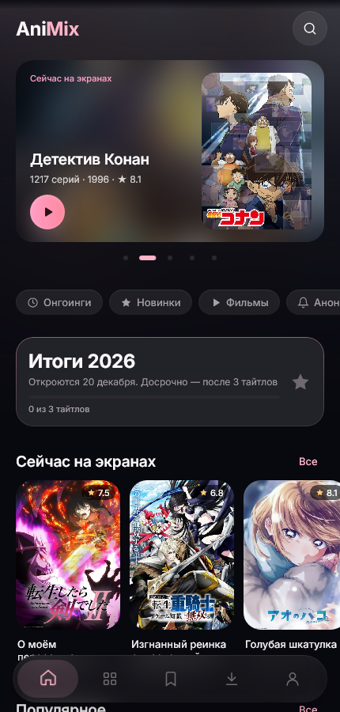
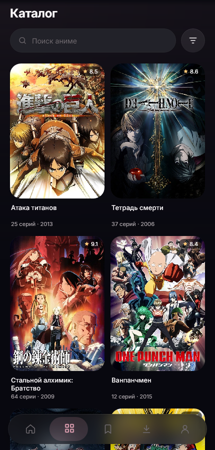
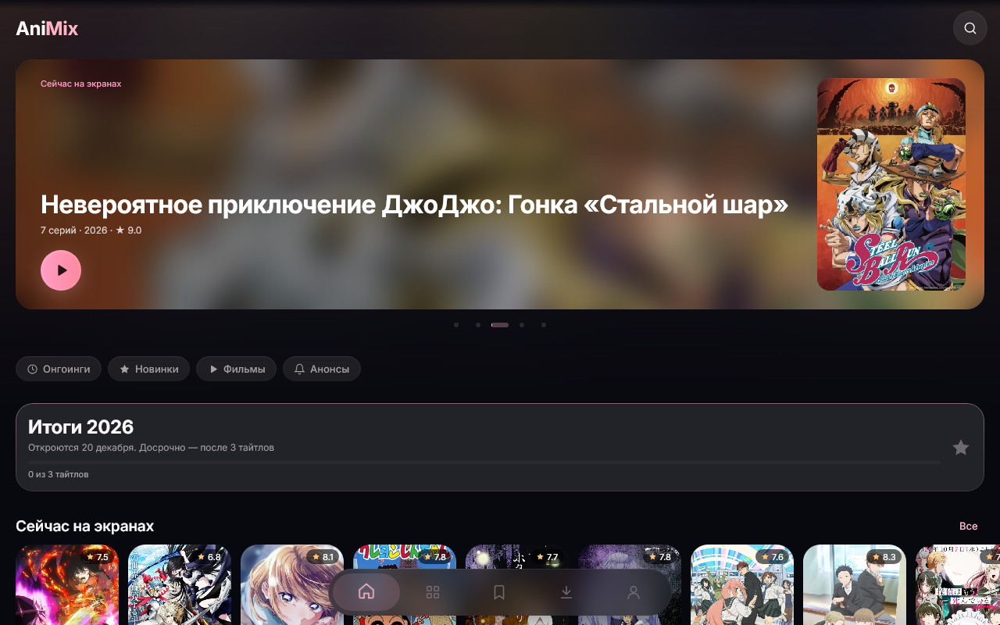

# AniMix · New Horizons

**AniMix** — приложение для просмотра аниме на Android и Windows. New Horizons — перерождение первого AniMix: одно приложение на телефоне и ПК, свой плеер, загрузки, онлайн-профиль и синхронизация между устройствами.

Текущая версия — **1.1.1 re** «Improved user experience».

<p>
  
  
</p>


## Скачать

**[Последний релиз](https://github.com/Wengine-wq/AniMix/releases/latest)**

| Платформа | Файл | Установка |
| --- | --- | --- |
| Android 8.0+ | `AniMix-<версия>-re-universal.apk` | Откройте APK и разрешите установку. Ставится отдельным приложением и не заменяет другие версии AniMix. |
| Windows 10/11 (x64) | `AniMix-<версия>-re-Windows-x64.zip` | Распакуйте в постоянную папку и запустите `AniMix\AniMix.exe`. VLC устанавливать не нужно. |

Новые версии приложение находит само и предлагает их на главной. На Android скачивается APK и открывается системный установщик. На Windows обновление скачивается и ставится после закрытия AniMix, затем приложение запускается снова. Настройки, списки и загрузки сохраняются.

## Возможности

- **Каталог и поиск.** Shikimori и YummyAnime в одной выдаче. Фильтры по типу, жанрам и году сохраняются при переходах.
- **Встроенный плеер.** Выбор озвучки и качества, полноэкранный режим, автопереход, пропуск опенингов и эндингов, продолжение с места остановки.
- **Загрузки.** Очередь серий с выбором озвучки и качества, просмотр без сети, офлайн-автопереход.
- **Watch flow.** Очередь серий под свободное время с прогнозом окончания и остановкой по лимиту; можно смешивать разные тайтлы.
- **Онлайн-профиль.** Вход через Google. Списки, оценки, просмотренные серии, часы, достижения и оформление профиля синхронизируются между устройствами — без дублей и без потери записей, в том числе без сети с отправкой позже.
- **Horizon Link.** Начали серию на одном устройстве — продолжите на другом с той же озвучкой, качеством и позицией.
- **Друзья.** Поиск по имени, заявки в уведомлениях, онлайн-статус, профиль друга со статистикой и коллекцией (если друг её открыл).
- **Профиль и уровень.** Аватар, баннер, описание, закреплённое достижение, уровень кольцом вокруг аватара, активность и любимые жанры.
- **Достижения.** За подтверждённый просмотр, коллекцию и привычки, включая секретные. Перемотка, повторы и перевод часов наград не дают.
- **Итоги года.** Истории о вашем годе в AniMix с музыкой и анимацией.
- **Перенос данных.** Импорт списков из Shikimori и Anixart; перенос списков, часов и достижений из локального профиля AniMix 2.x.
- **Светлая и тёмная темы**, экономия батареи и отключение анимаций.

## Из чего состоит

| Папка | Что внутри |
| --- | --- |
| `shared` | Весь интерфейс (Compose Multiplatform), тема, навигация, данные: каталог, плеер, загрузки, библиотека, достижения, аккаунт и синхронизация. |
| `androidApp` | Точка входа Android, манифест, подпись релиза. |
| `desktopApp` | Точка входа Windows, окно, упаковка с комплектным VLC. |
| `server` | Сервер аккаунтов на Node.js + PostgreSQL: вход через Google, профили, синхронизация, друзья, Horizon Link. Развёртывание на VPS — `server/deploy`. |
| `docs` | Правила интерфейса и описания подсистем. |

## Сборка

Нужны JDK 21 и Android SDK (путь в `local.properties`).

```powershell
$env:JAVA_HOME = 'D:\DevTools\jdk-21.0.12.1+1'
.\gradlew :desktopApp:run                         # запустить на Windows
.\gradlew :shared:desktopTest                     # тесты
.\gradlew :androidApp:assembleDebug               # отладочный APK (ставится отдельно: app.animix.newhorizons.v3dev)
.\gradlew :androidApp:assembleRelease             # релизный APK, подписанный ключом из %USERPROFILE%\.animix\release.properties
.\gradlew :desktopApp:createReleaseDistributable  # папка AniMix для zip-релиза
```

Первая сборка для Windows скачивает и проверяет по контрольной сумме среду VLC (около 82 МБ).

Сервер:

```powershell
cd server
npm install
npm test
powershell -File deploy\deploy.ps1 -Ip <IP сервера>
```

Подробнее — [server/README.md](server/README.md).

## Версии и релизы

Версии линии **re** нумеруются `1.<minor>.<patch> re`, тег релиза — `v1.<minor>.<patch>-re`, versionCode = 3000 + minor × 100 + patch. Приложение предлагает обновление только из релизов с таким тегом. Как выпустить исправление — [docs/app-updates.md](docs/app-updates.md).

## Документация

- [Правила интерфейса](docs/interface-guidelines.md)
- [Синхронизация онлайн-профиля](docs/account-sync.md) · [Друзья, Horizon Link, итоги года](docs/social-horizon-review.md)
- [Просмотр, уровень и экономия батареи](docs/viewing-levels-power.md) · [Watch flow](docs/watch-flow.md)
- [Плеер и загрузки](docs/native-playback-downloads.md) · [Онлайн-профиль и миграция с 2.x](docs/legacy-migration.md)
- [План следующей версии](docs/roadmap.md)

## Лицензия

Код — [MIT](LICENSE). Шрифт Inter — SIL Open Font License ([licenses/OFL-Inter.txt](licenses/OFL-Inter.txt)). Сведения о комплектном VLC — [licenses/native-video.md](licenses/native-video.md). Названия, постеры и описания аниме принадлежат их правообладателям и загружаются из открытых каталогов.
